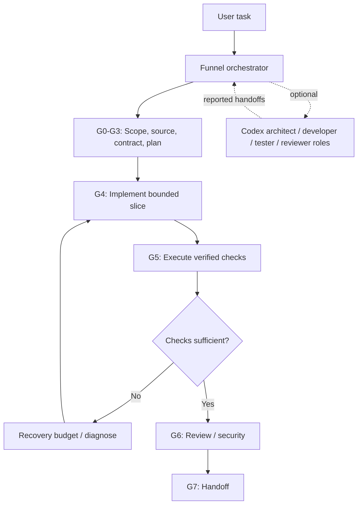

# v4 system architecture

The **master Funnel skill** selects task tracks and specialist methods; its eight checkpoints are enforced by a separate Python CLI. Four optional Codex subagent role configurations extend this to actual delegation when the host supports it. The CLI's `handoff` command is only a **brief**, not a spawn action.

## Engineering boundaries

- `AGENTS.md` and project instructions take precedence over these generic skills.
- Source fingerprint hashes common code/config files in the selected project; it excludes `.git/`, `.funnel/`, dependency and generated folders. This is *not* a replacement for immutable revision/digest mapping in CI.
- Gate PASS is an assertion supported by evidence paths and hashes. The required `test` check binds to current source state **and must postdate G4**; high-risk work also requires a `security` check. Current scripts' exit codes alone do not measure coverage.
- Recovery has a finite budget; upstream scope changes reopen earlier gates and revoke downstream statuses. The CLI neither fixes bugs nor rewrites source automatically.
- Subagent roles use Codex's supported TOML configuration mechanism. A successful load is not proof that a role was spawned. The controller must invoke real subagent capabilities if available and observe their results.
- No background orchestration, uncontrolled recursion, provider/model override, autonomous publication, production database access or auto-deployment.

## Role handoff contract

Provide: task goal, exact repository state, assigned directories or files, allowed changes, excluded paths, expected artifact, verification and stopping criteria. Prevent concurrent writes to shared files. An architect and reviewer should work read-only when possible; a developer may modify its bounded slice; tester observes test results. Independent review must not be self-labelled.

## High-risk work

Security-sensitive code, destructive migrations, permissions and payment flows should be marked `--risk high`; that adds a security-check command requirement to G5. This is **procedural enforcement**, not a claim of comprehensive security testing. Require explicit human approval for deployment or production effects.
